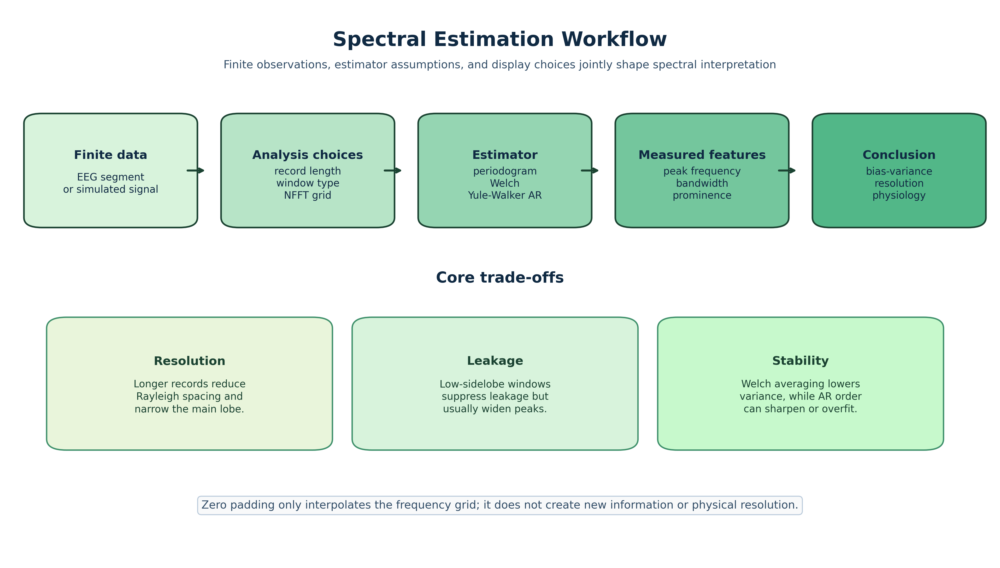
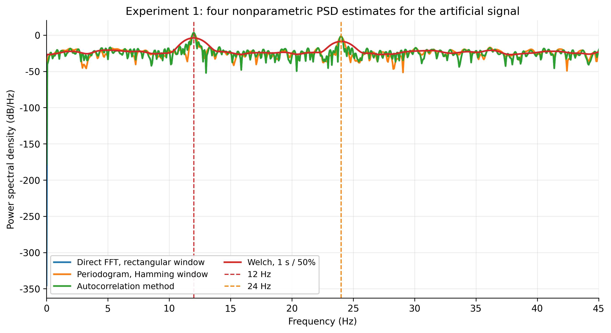
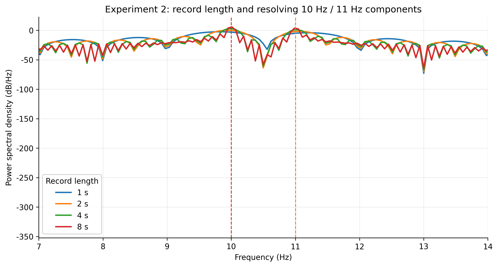
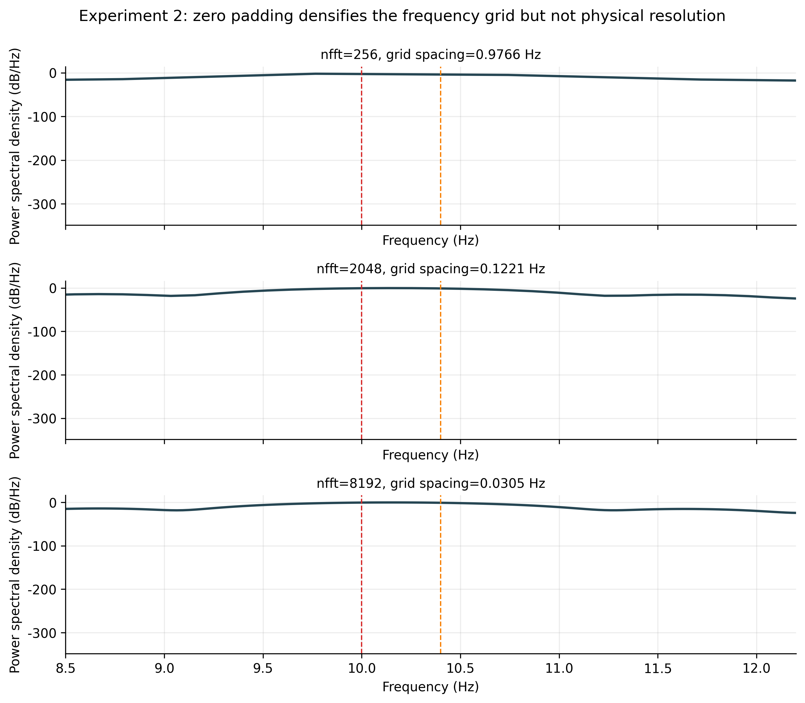
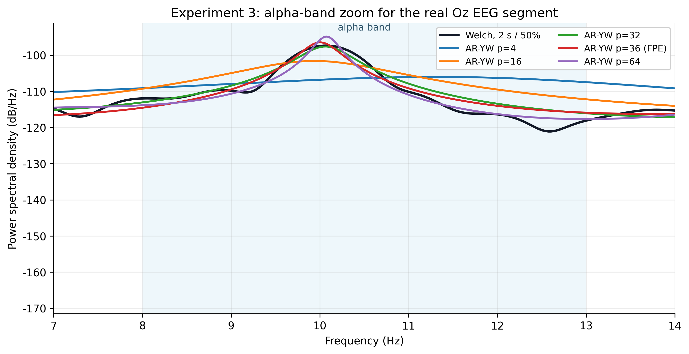
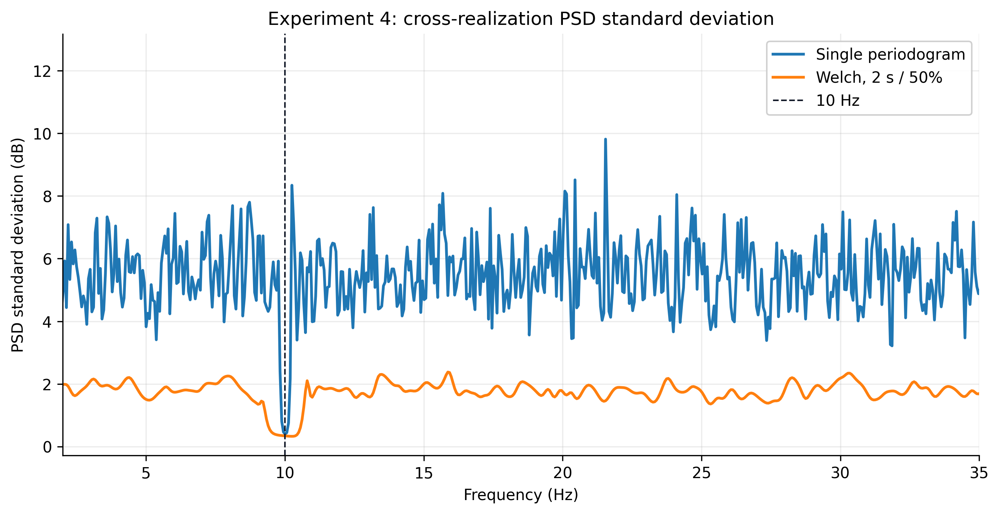

# Spectral Estimation on Synthetic Signals and Closed-Eye EEG

This repository contains a reproducible Python implementation of a medical signal processing lab on spectral estimation. It compares classical nonparametric methods and AR parametric spectra on synthetic signals and LEMON closed-eye resting-state EEG.

## Reports

- [English report PDF](outputs/pdf/Spectral_Estimation_Lab_Report_EN.pdf)

## Method Overview



The project focuses on estimator choice rather than only calling spectrum functions. All spectra are reported as absolute one-sided power spectral density in `dB/Hz`, without per-curve normalization.

Core topics:

- direct FFT, Hamming periodogram, full-lag autocorrelation, and Welch PSD estimates
- spectral leakage, window sidelobes, main-lobe width, and record-length resolution
- the difference between NFFT interpolation and physical frequency resolution
- Yule-Walker AR spectra, FPE order selection, and pseudo-peak risk
- periodogram variance and the stability-resolution trade-off of Welch averaging

## Selected Results

### Classical PSD Estimators



The artificial signal contains a 12 Hz fundamental and a 24 Hz harmonic. The four PSD estimators identify the main component, but differ in harmonic visibility, background floor, and curve roughness.

### Record Length and Resolution



Longer observation windows reduce the Rayleigh spacing `1/T`, deepen the valley between close peaks, and narrow the main lobe. This is different from zero padding, which only samples the same Fourier transform more densely.

### NFFT Interpolation



Increasing NFFT makes the frequency grid smoother, but the 1 s record still cannot physically resolve the 10 Hz and 10.4 Hz components as stable independent peaks.

### Welch vs. AR Spectra



AR spectra can produce sharper alpha peaks under short data, but this sharpness depends on model order and can introduce pseudo-peaks. Welch is smoother and more stable, but its short-segment averaging limits resolution.

### Welch Averaging and Variance Reduction



Welch averaging reduces pointwise PSD variance across realizations. The trade-off is a wider peak when shorter segments are used.

## Repository Structure

```text
src/
  spectral_methods.py     Core PSD estimators and metrics
  data_io.py              EEGLAB/MNE loading and Oz segment extraction
  plotting.py             Shared plotting style for the Chinese figures
experiments/
  run_all.py              Reproduce all numeric metrics, caches, and Chinese figures
  run_all_en.py           Render English figures and the mechanism diagram
  exp1.py ... exp4.py     Individual experiment implementations
report/
  report.tex              Chinese LaTeX report
  report_en.tex           English LaTeX report
  build_report.py         Build Chinese tables and PDF
  build_report_en.py      Build English tables and PDF
sub-032481/
  sub-032481_EC.set       Original EEG metadata
  sub-032481_EC.fdt       Original EEG signal data
outputs/
  figures_en/             English figures used by README and report
  tables/                 CSV metrics generated by experiments
  pdf/                    Final English report PDF
```

## Reproduce from Scratch

The project was developed with Python 3.12. Install dependencies:

```powershell
python -m venv .venv
.\.venv\Scripts\python.exe -m pip install --upgrade pip
.\.venv\Scripts\python.exe -m pip install -r requirements.txt
```

Run all experiments and regenerate CSV metrics:

```powershell
.\.venv\Scripts\python.exe -m experiments.run_all
```

Render the English figures:

```powershell
.\.venv\Scripts\python.exe -m experiments.run_all_en
```

Build the English report:

```powershell
.\.venv\Scripts\python.exe report\build_report_en.py
```

Build the Chinese report:

```powershell
.\.venv\Scripts\python.exe report\build_report.py
```

PDF compilation requires TeX Live with `latexmk` and `xelatex` available on the command line.

## Notes

- The real EEG fallback reader converts EEGLAB microvolt-scale `.fdt` data to volts using `1e-6`, matching MNE's `raw.get_data()` convention.
- The autocorrelation implementation uses biased full-lag autocorrelation, so it is theoretically close to the direct rectangular-window FFT through the Wiener-Khinchin relation.
- The real EEG FPE minimum can be extremely small and is reported in scientific notation in the English and Chinese tables.
